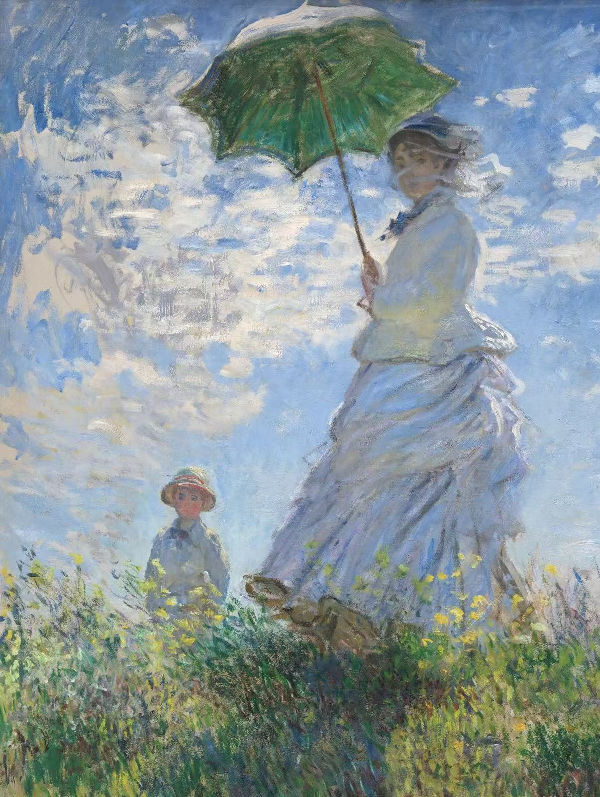
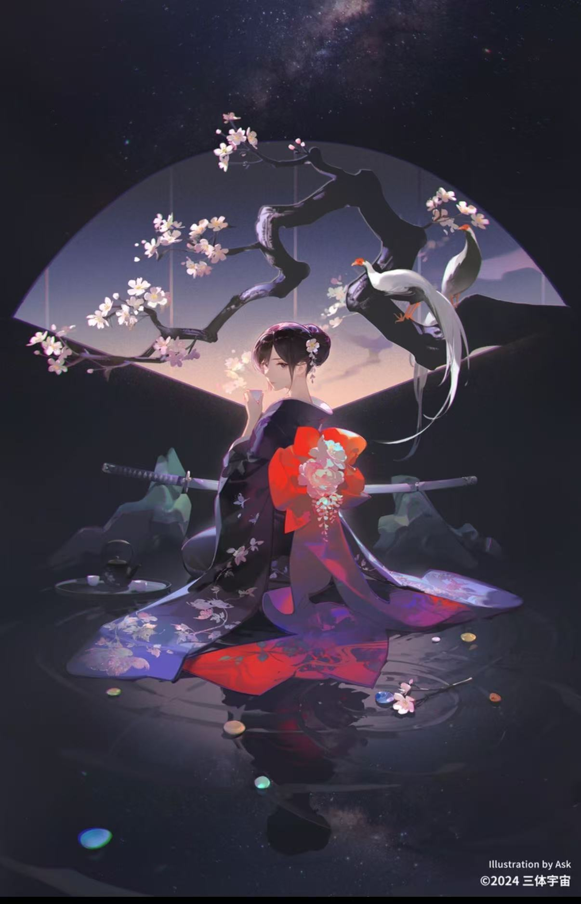
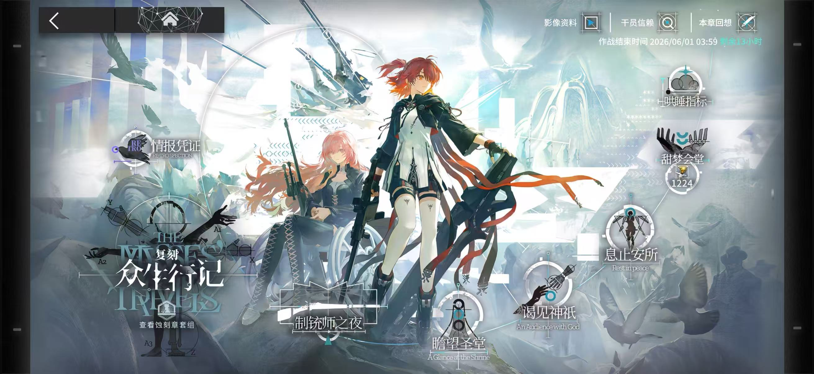

# 画作
## 莫奈 撑阳伞的女人

- 女人、阳伞、影子连成弧线纵向贯穿画面，和小男孩构成三角形使画面更稳定。画面采用仰视角度，拉高人物身形，显得更加高大、渺远。
- 人物主体位于画面中心偏右，容易吸引目光，阳光、裙摆、阴影、男孩分布集中连贯，引导视线。
- 整体色彩明亮清新，以蓝绿白为主，多用橙黄等亮色使画面更具生命力。裙摆藏色丰富，阴影处采用环境色补色画面更透气。通过色彩的准确运用而非细腻刻画，来表现草地和裙摆的缎面等材质。
- 笔触较细碎，省略细节把握整体光影。采用厚涂技法。（是吗？我不知道）
- 画面人物是莫奈的妻子和儿子。这副画描绘家庭外出郊游的场景，传递轻松愉快明媚的情绪。

# ACG作品
## ask 会面

- 人物及拉开的衣摆构成三角形，使画面重心稳定。加上上方扇形整幅图主体呈扇形，视觉上沉静但不凝滞。横贯的武士刀和白鹤樱花等小物打破画面规整的格局，增添张力和灵动感，避免死板。扇形和涟漪的弧线相呼应近似完整的圆，使构图更紧凑完整。背景星空增加画面纵深感。
- 画面明暗对比明显，实现首先被画面中央人物面部和橘红的绸带吸引，随后向较暗的四周延展。通过明亮的橘红和深色的紫黑对比，画面饱和度对比明显，具有视觉冲击力。光线为逆光。通过对色彩运用塑造衣物丝绸质感。通过破型笔刷等刻画枝干。
-笔触细腻，结合平涂厚涂，通过白鹤茶樱花武士刀等意象表现人物特征。
- 这副画描绘等待程心罗辑会面的智子，表现她的平静忧伤美丽温婉危险。

# 游戏UI
## 明日方舟 众生行记UI
-
- 画面中部是角色立绘，色彩饱和度较高吸引视线，后方通过剪影和几何图形留白避免视觉上拥挤感，关卡等功能键在右下连成弧线与背景线条相契合。整体上疏下密上明下暗节奏得当。
- 主标题众生行记字号最大，瞻望圣堂等选关键较小，影像资料等字号更小，等级清晰利于理解。标题采用特殊设计的字体契合活动特色，其余大部分字体采用无衬线黑体下加阴影保证易于辩识。
- 画面色彩以蓝灰白为主，角色头发的暖色提亮画面增强对比。画面中圣堂、白鸽、铳等意象叠加营造神圣氛围，符合活动情节。大量几何图形及色块增强工业感。整体符合明日方舟机能重工风格。
- 作为游戏UI，大部分功能键位于边缘利于操纵，动态效果展现屏幕媒介优势。

*选关界面UI也特别美…*

# 电影
## 娄烨 苏州河
- 采用手持摄影晃动频率极高，营造飘摇、不确定感。影片开篇的长镜头摄影师以第一人称沿苏州河顺流而下，镜头在建筑、路人、水面间来回跳动，灵活穿插近景中景远景。牡丹跳河前的长镜头焦距反复改变，营造不确定感。马达偷窥美美换装的长镜头，表现马达的犹豫和水箱中的美人鱼实为世俗凝视对象的本质。
-全片色彩基调偏灰暗冷硬，聚焦苏州河沿岸破败的民居和底层人民的市井生活。影片用16mm胶片拍摄，颗粒感强，产生粗粝质感。
- 影片剪辑风格跳跃，叙事碎片化，增强了无序感，与手持摄影结合，营造不安的氛围。多车声、工地劳作声等生活中真实声音，具有金属质感。
-  影片采用第一人称叙事，开篇“我的摄像机从不说谎”和“我在撒谎”的矛盾，建立一种不可靠叙事。使观众无法确定内容是否真实。影片中美美在腿上贴上牡丹花，她逐渐接受牡丹的身份，隐喻都市漂泊中人的身份、情感和肉体同样居无定所。